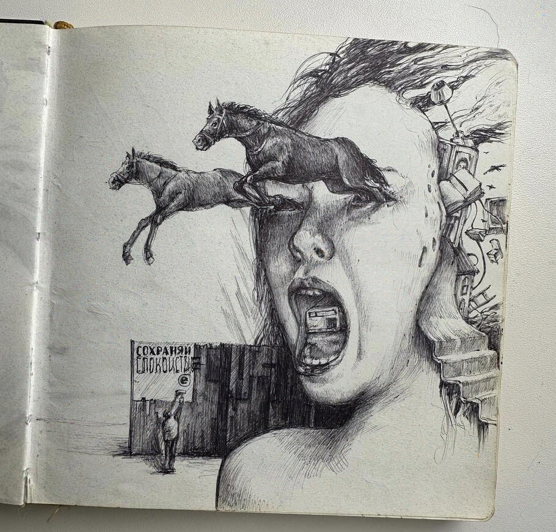
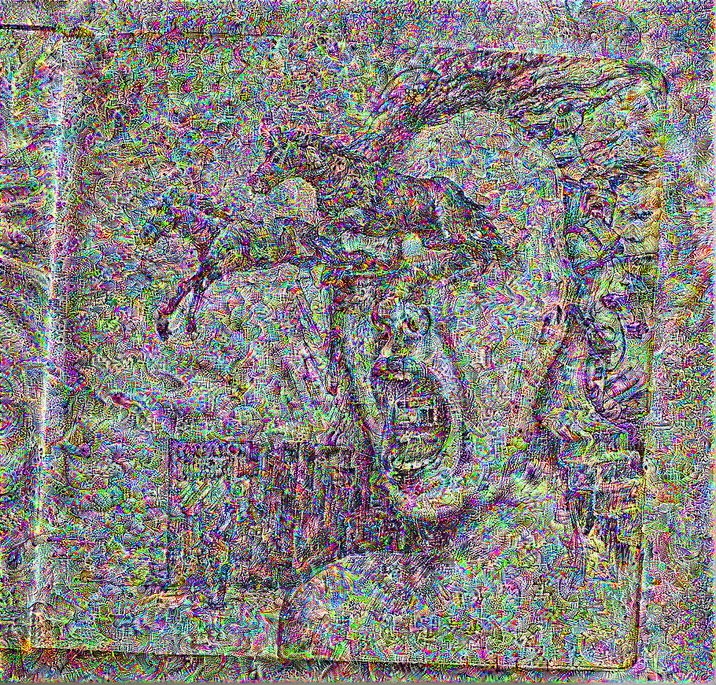
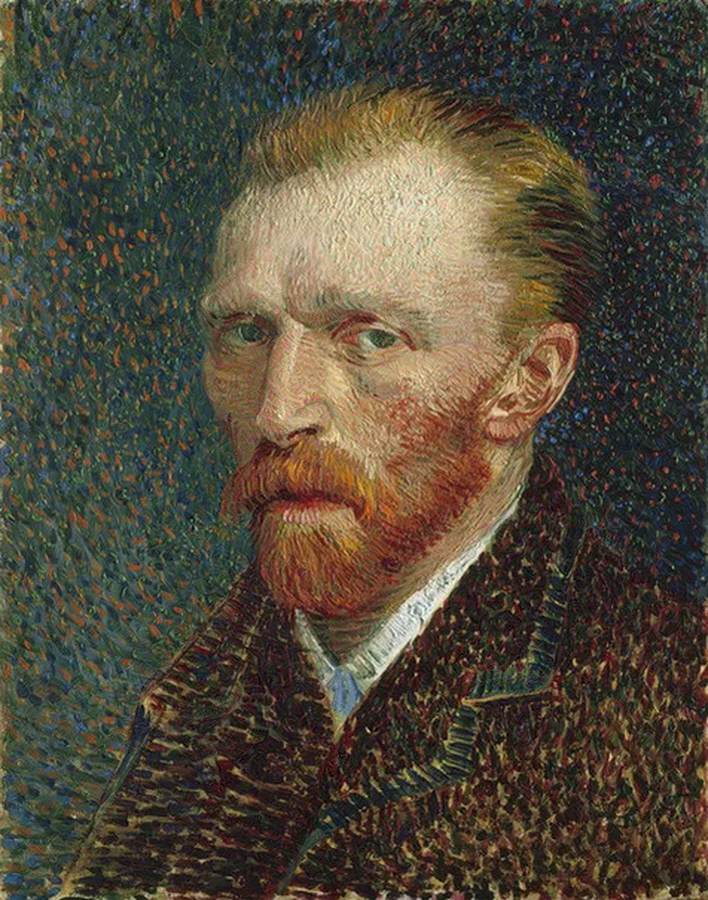
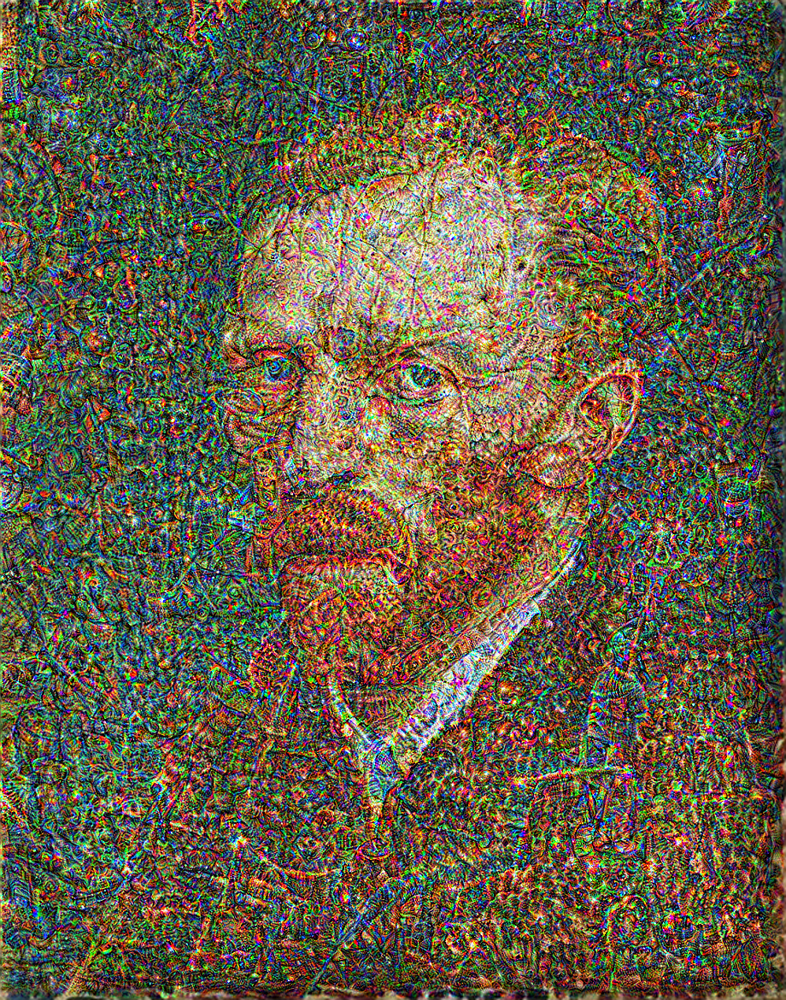

# DeepDream — Multi-Scale Feature Amplification with NASNetLarge

An implementation of DeepDream: the system takes a single input image and progressively rewrites it so that the features a pre-trained **NASNetLarge** network already detects in it become stronger and more pronounced.

The network is frozen and never updated, while the pixels of the image are the only thing that changes. The objective is **maximised rather than minimised** (no target to converge on, only the network's own activations to drive upward). The output is the feature vocabulary the network learned from ImageNet, made visible.

Built with Python, TensorFlow and Keras. The images used to test the pipeline are drawn in part from the Wartime Art Archive (website): ([website](https://waa.umca.art/en)).

## Functionality

Executing `main.py` loads the input from `data_files/`, runs the multi-scale dream loop, and writes progress frames and the final image to a timestamped folder under `outputs/runs/`.

| Step | What happens |
|---|---|
| 1 | The input image is loaded, resized to **331 × 331** with Lanczos resampling — NASNetLarge's native input size — and preprocessed by `nasnet.preprocess_input` into the `[-1, 1]` range |
| 2 | **NASNetLarge** is loaded with ImageNet weights and `include_top=False`, discarding the classifier head and leaving the convolutional feature extractor |
| 3 | Target layers are chosen automatically: of the network's last 30 layers, those whose names contain `normal` or `relu`. The model is rebuilt to emit all of them at once |
| 4 | **Loss** = the sum of the mean activation of every target layer. This value is *maximised*: a higher mean activation means the image contains more of whatever those layers respond to |
| 5 | `tf.GradientTape` takes the gradient of that loss with respect to the image. The gradient is divided by its own standard deviation, so the step size behaves consistently no matter how large the raw activations are |
| 6 | The image is updated by `image + gradients * step_size` — gradient **ascent**, not descent — then clipped back to `[-1, 1]` |
| 7 | **Octave loop:** the whole process repeats at four increasing scales (`1.0, 1.4, 1.8, 2.2`). Each octave resizes the current image upward and dreams again, so patterns form at both fine and coarse scales instead of one texture size only |
| 8 | Every 150 steps, and on the final step of each octave, a progress frame is written to the run folder. The finished image is saved as `dream_final.jpg` |

DeepDream has no target for minimisation. The quantity being raised is the network's own response, so the optimisation drives the image toward whatever the selected filters were trained to detect. The recurring eye-like and animal-like motifs in the output are those learned features made explicit.

`video.py` is a separate utility that stitches a numbered sequence of progress frames into an AVI with OpenCV at 10 fps.

## Results produced so far

Each pair is the first and last saved frame of a single run — the unmodified input on the left, the same canvas after the full sequence of ascent steps on the right.

### 1 — Ballpoint sketch (WAA artwork)

| Input | After amplification |
|---|---|
|  |  |

### 2 — Painted portrait

| Input | After amplification |
|---|---|
|  |  |

- **Features are amplified** The patterns follow the structure already in the image — the strongest growth where the original had edges, contrast and texture.
- **The network's vocabulary surfaces.** Textures generated based on what the selected NASNetLarge layers respond to most strongly.
- **Saturation climbs with step count.** Because the loss has no upper bound and the only limit is the clip to `[-1, 1]`, colour intensity keeps rising the longer the loop runs.

## Testing

**Prerequisites:** Python 3.12, and free space for the NASNetLarge ImageNet weights, which Keras downloads and caches automatically on the first run.

**Steps:**

1. Create and activate a virtual environment, then `pip install -r requirements.txt`.
2. Place the input image in `data_files/` as `sample.jpg`.
3. Run `python main.py`. Octave, step and loss are printed continuously; progress frames appear in a new timestamped folder under `outputs/runs/` as the run proceeds.
4. To build a video from a numbered frame sequence, run `python video.py`. It reads `outputs/progress_frames/run_1/` and writes `outputs/videos/deepdreamvideo.avi`.

> **Run time.** Each optimisation step requires forward evaluation of the selected NASNetLarge feature layers and backpropagation of gradients to the image. Processing time depends on hardware, image resolution, octave configuration and iteration count. The main script is configured for 1,000 steps per octave, while the run_deep_dream_multiscale function defaults to 800 steps.

To change the balance of the result, adjust the arguments to `run_deep_dream_multiscale`: `steps` controls amplification intensity, `step_size` intensity of each update, and `octaves` the range of pattern scales that form.

## Repository layout

```
main.py                     Image loading, loss, ascent step, octave loop and output
video.py                    Stitches a numbered frame sequence into an AVI
requirements.txt            Pinned dependencies
data_files/
  sample.jpg                Input image
outputs/
  runs/
    1/                      Multi-scale run — octave 1 complete, octave 2 partial
    2/                      Multi-scale run — octave 1 complete
  progress_frames/
    run_1/                  Numbered frame sequence from an earlier single-scale run
    run_2/                  Numbered frame sequence from an earlier single-scale run
    source_image.jpg        Input used for those earlier runs
  videos/
    deepdreamvideo.avi      Assembled by video.py from progress_frames/run_1
```

## Tech stack

Python 3.12 · TensorFlow 2.16 · Keras 3.1 · NASNetLarge (ImageNet weights) · NumPy · Matplotlib · Pillow · OpenCV

## Scope and limitations

* **Computation Time.** The cost per octave rises with its scale factor, and a complete run is not optimised.
* **Input geometry is fixed** Images are forced to 331 × 331 regardless of their shape, and the output resolution is set by the octave multipliers rather than chosen.
* **`video.py` only matches one frame set.** It expects sequentially numbered files at a hard-coded 910 × 605, which fits `outputs/progress_frames/run_1` alone.
